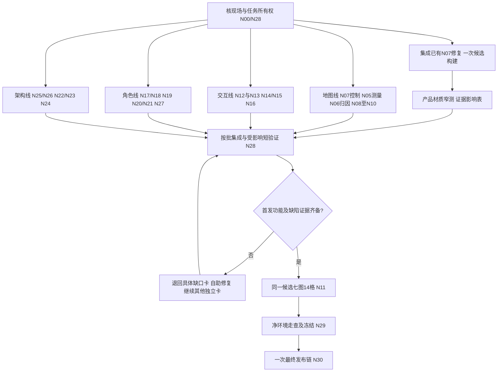

# 项目连续执行路线图与多实例任务包

> 2026-11-18最新接续：[全项目任务清单与连续执行顺序](PROJECT-EXECUTION-UPDATE-2026-11-18.md)。该文件更新了GitHub/main快照事实、companion循环位已修项、已有未合入工作线、N00–N30具体出口及架构队列；以下旧读数保留历史身份，不作当前产品通过证明。

更新：2026-11-17；集成树 `work/integrate` 本轮基线 `2305215`，父提交为功能合并tip `d5037e58`。本轮改动尚未提交；world FOV代码已定向构建、camera_probe通过、同demo/tick隔离帧已抓取；完整视觉/UI门禁未跑。

这是执行顺序和失败处理入口；详细步骤沿用 `PROJECT-NEXT-TASKS-2026-11-14.md` 的N00–N30，当前状态沿用 `N-STATUS-2026-11-14.md`，历史报告不能覆盖这两个文件的最新快照。

## 1. 当前出发点与范围

| 已有交付 | 能接受的结论 | 尚欠的证据/功能 |
|---|---|---|
| gate3判定与整门 | 旧exe cfcdbe5d：35/35、542s；声音census窗口无输入即红 | 未绑定新产品；稀疏累计区间不证明每个事件完整，M4判词自检不等于当前源码变异实跑 |
| gate5判定与整门 | 旧exe cfcdbe5d：158/0；91/2未变异反例会被拒绝 | 新候选资源路径影响待验；同序列跨时间姿态证据与全槽位实际GPU绘制另列 |
| N07具名清单及查找修复 | 0dfcd356已入库；探针七图VMT缺失0、closure=1；共享查找挂载HL2，TF优先 | 产品未重建验证；water分类、坏资产控制和可见材质/物件签收未齐 |
| N05诊断 | 隔离3索引、1 draw；洋红109px与CPU预计约1289px²存在差异 | SO只是方案，未实施；D03 OPEN，不能称已定因VS/裁剪/光栅 |
| 工程底座 | 已有tf2_core、构建身份与公共runner/hostlock | 构建实测、门禁影响分级/帧复用、主循环下一切口、/W4和失败注入仍欠 |
| 产品其他域 | N12三步、N13命令状态首步已入库，有各自历史窗口 | 用户路径、多视角、动作武器、三效果、导出、最终七图验收未齐 |
| N02–N04既有有限验收 | Unicode/路径探针本卡、隔离守卫、安全八类具名检查已有交付 | 保留已完成范围；扩展探针/新严重缺陷另开子片，不因本窗口没重跑而退回未开始 |
| 2026-11-17集成视觉 | 天空、位移格点、entity二次染色、未知开关、map overview/HUD有报告级读数 | pr600仍94px几何剔除、14个退化patch平面fallback、world-material基线红、若干门禁未对本exe复跑；Odyssey pin不属首发 |
| Scout外观与探针 | integrated-up0.png显示人物外形异常；报告测得屏外像素0，排除画面裁切；本轮确认世界投影误用ViewModel FOV并已窄修复 | Scout本体仍需同demo/tick/entity相机对照和全模型外形/UV/骨骼视觉门；先绑定修正后的FOV，再查动画/材质/mesh与探针覆盖 |

首发严格为七图：cp_process_f12、cp_sunshine、cp_gullywash_f9、cp_sultry_b8a、koth_product_final、koth_bagel_rc11、pl_upward_f12；普通pl_upward只作独立补充样本，Odyssey不在首发。

基础地形、材质、物件、天空、控制点、推车和基础水面均需正确；现阶段不做新增光影/阴影、玻璃反射、水反射/折射或ragdoll。特效只做Pyro火焰、Medic治疗束、流血；不能借排除反射把基础水面也删掉。

## 2. 执行方式：完成即接下一张，不逐步等指令

1. 接到一个任务包后，先核当前分支/HEAD、已有脏文件、依赖和锁；现场比文档新时，以可核证据更新身份，不能覆盖他人改动。
2. 每位执行者同时只做一张实现卡，可排两到三张后续卡；本卡完成记录证据并直接取下一张，不反复问“要不要继续”。有子任务通过只关子任务，不把整卡提前打勾。
3. 正常bug先读真实代码/入口→最小复现→最便宜的区分性测量→修证实根因→正控+缺陷负控→受影响短回归；编译通过、probe成功和像素正确分开记。
4. 失败时自行选仓库已有工具、平台原生诊断或标准库继续定位；不能删断言、改正式素材、乱重钉或用未变异读数也能通过的谓词换绿，不能用猜测代替复现。
5. 同一环境问题连续失败两次即停止该环境路线，保存两次报错原文、尝试和所需人工事项；该卡保留阻塞，执行队列中下一张独立卡，不重复空跑。逻辑bug按新证据改排查方向，不套“两次任意测试失败就放弃”。
6. 复杂诊断连续60–90分钟没有新增区分性证据时作一次检查点：写最小复现、已排除项、下一项测量和成本，换测量或转独立卡；这是排程规则，不是超过时限就宣告不可修复。
7. 只有无法取得的输入、外部环境或真实范围冲突才向负责人提具体问题，同时继续不依赖它的工作；此前已授权的native修复、LF规则、已定功能不再次申请。
8. 不在台账里冒充派发：角色可由用户映射到真实实例；本文未创建或向其他聊天发送任务。push/tag/release仍须后续明确发布安排。

### 2.1 源码和数据参考规则

完整站点表与用途边界见 [`TF2-SOURCE-REFERENCE-INDEX.md`](TF2-SOURCE-REFERENCE-INDEX.md)。人物/相机/武器/材质任务优先检查OthmanAba/TeamFortress2的TF2实现；共享Source机制查Valve Source SDK 2013，TF2-Base用于结构交叉对照；demo和地图格式至少挑独立解析器做关键字段/几何交叉验证。执行者记录repo URL、commit/ref、文件/符号及结论；再以当前TF2资产、demo样本和产品读数确认。源代码参考帮助找到该测什么，不能替代运行时证据。

## 3. 总路线与完成后的去向



各功能/架构线从现场核对后即可准备，不等所有历史门禁重跑；合入同一候选与运行窗口须串行协调。N05是地图线的一张诊断卡，不能作为全项目开工前置。

## 4. 建议一次分配的四个任务包

角色约定：A集成、B验收、C地图、D相机/UI、E角色/音频、F工程、G资产；人少可合并，B由非作者交叉复核，不要求再开一个专职实例。

| 执行实例 | 一次领取的有序队列 | 下一步自动触发条件 | 主要写域及预约 |
|---|---|---|---|
| 实例1：A/F工程与集成 | R0现场→R1候选构建→E1门禁效率→E2构建实测→E3工具链/警告→E4主循环一片 | 当前片有证据即接下一片；其他线就绪时预留短集成窗口 | 构建目录、CMake、公共runner、属性文件；main切口先与实例3约定 |
| 实例2：C/G地图 | M1 N07控制/产品签收→M2 N05 SO→M3 N06→W-PR600/W-DISP-14/W-MATERIAL→M4 N08/N09/N10 | N05缺测量或阻塞时先做独立地图项；首发缺陷先于Odyssey非首发pin | BSP/VMT/VPK及world renderer；与实例4预约shader/frame公共文件 |
| 实例3：D交互 | U1 N13 A1–A7/优先级→U2 N12 relay/身份→U3 N14/N15→U4 N16双窗→PIP | 每一接口片稳定即可前进；不重做N12已落地三步 | main相机/UI、窗口/布局；共享main只给一个写入者 |
| 实例4：E角色/音频/导出 | P0 N17-PROBE覆盖审计+Scout同帧视觉对照→P1 N17/N18→P2 N19→P3 N20/N21→P4 N27 | Scout层级差异判清后修最小根因，再扩职业；无设备先做失败路径 | 动画/model/viewmodel、音频、导出；避免与实例2并改共用renderer/shader/CMake |

如果只有一位执行者，按R0→R1→M1→U1→E1→U2→P1→M2顺序交替推进；后续按实际依赖继续，不把架构或用户可见功能留到全部诊断之后。

## 5. 当前最先完成的两步

### R0：登记现场并确定小批候选（A/F，N00/N28）

- 记录HEAD、native内容身份、现有exe/sidecar、BSP/demo/资源根与已脏文件；报告当前exe为6f3e64cd仅作待现场复核值，不能抄成实测哈希。
- 保留用户文档与既有.gitattributes补丁；确认0dfcd356的共享查找改动已在树中；不顺手把全部待办合进第一批。
- 成功→R1；身份不一致→先判断未重建/旧sidecar/其他工作树，不改旧证据身份掩盖差异；锁被占用→安排下一窗口，先做只读分析或隔离工作树实现。

### R1：一次构建，先确认N07修复进入产品（A/F+B，N28/N07）

- 从仓库现有构建入口确认真实目标/参数；只构建产品与实际受影响probe，正常增量构建即可，只有重现依赖污染才clean；核内容身份与no-op。
- 固定候选进行TF/BSP-pak/HL2各一具名正控、TF优先级冲突控制和伪路径拒绝；再测一处产品可见HL2材质与暂停/seek，图像和日志绑定本次身份。
- 对gate3/gate5列影响表：共享资源查找/加载和gate5材质路径优先补测；gate3审声音依赖，若受影响跑本门（历史542s仅作预算），不等同跑完整发布链。
- 成功→M1扩控制、各线继续；probe绿产品红→查产品挂载/IncludeReader与实际加载入口；构建失败→最小目标定位，不为环境问题修改正式逻辑。

## 6. 地图线的连续步骤（实例2）

| 步骤 | 要做的最小产品/验证片 | 完成后做什么 | 失败时自行走的分支 |
|---|---|---|---|
| M1 / N07 | 复用已实现具名链；water独立stage并计closure；坏VMT/VTF、缺include、空资产及优先级正负控；实际可见材质/物件签收 | 小片通过→M2；N07保持部分直到物件/材质逐项签完 | 先分缺资源/解析不支持/绘制错误；不重新只查tf2_misc，也不继续开发重复list-missing |
| M2a / N05 | SO测量接实际世界VS输出，先已知简单三角形控制，核返回数量/坐标/rc，关闭诊断默认行为不变 | 控制过→M2b | 控制失败先修仪表；SO是D3D11管线输出机制，不把方案“VS阶段声明SO”直接当实现接口 |
| M2b / N05 | 同次绑定VB/IB/常量，回读19539的clip及帧/index/viewport/scissor/状态身份，恢复管线 | clip不同→实际输入/常量；clip同→逐平面裁剪/viewport/覆盖/深度；定因后最小修复→M3 | 正w不排除全部裁剪；洋红轮廓角不一定原顶点；保留849/919分账，不接受“唯一解释”无证推断 |
| M3 / N06 | 白噪/黑区/蓝面各一个具名同机位on/off，对照真实几何/材质与游戏参考 | 每族定性后扩受影响图→M4 | 单点不够则补区分性读数；正常资产效果/诊断bug/产品bug/未证分别登记 |
| M4a / N08 | 控制点neutral/capturing/RED/BLU样本，skin/bodygroup/占领数据、暂停/seek正确 | →M4b | 数据缺失与绑定错误分别复现，不用常量team遮盖 |
| M4b / N09 | 推车直线/弯道、停/动样本与parent变换；动态brush不重复、不留错原点 | →M4c | 查tick实体/变换/插值/绘制来源；单个样本缺失先做另一合法样本 |
| M4c / N10 | 先普通六面天空方向/接缝/遮罩，再实现真实sky_camera变换和3D skybox正控 | 地图域就绪→N11候选矩阵 | 资产缺面与3D skybox未实现分开，禁止六面天空PASS替代3D功能 |

N07零VMT缺失不证明水面、模型槽位或画面都正确；N05控制失败也不阻塞M1、U线及P线。

图二Scout外观是首个模型视觉验收案例。报告已测屏外像素为0，不能再把“被裁切”作为观察事实；本轮修复了世界投影误用ViewModel FOV。下一步锁定投影与同录制实体/tick，再用TF2源码和游戏参考隔离mesh/LOD、材质UV、骨骼姿态。现有model/tint门的局部PASS不能替代该对照。

## 7. 交互线的连续步骤（实例3）

| 步骤 | 交付及完成判据 | 成功后 | 失败处理 |
|---|---|---|---|
| U1 / N13 | 先验现有A1–A7，再接跟随/选人、三种视角的优先级与普通用户UI；A8历史未干扰证据保留 | U2；稳定target/mode接口交N16 | 分命令入队/状态生效/相机决策/绘制；名字无数据显示具名未知，不伪造选手名 |
| U2 / N12 | STV relay/目标、serial/跨demo/容量/包内顺序负控，B1用可区分68常量的样本；对照独立oracle | U3，N16复用 | 包内顺序0样本不当通过，补合成合法消息序列或另找输入；无真实导播相机只标PROVEN-FOLLOW |
| U3a / N14 | 先查demos.tf许可证/依赖/坐标与数据约定，安全且适配的代码优先复用；有更好方案则写明理由再选；补底图/独立比例/朝向 | U3b | 单控制点不能唯一证朝向，选多地标；许可证不明不直接搬；不把整站依赖引入native |
| U3b / N15 | DPI布局、resize、暂停/seek持续性，先数学边界再真实窗口；HUD不相撞 | U4 | 分坐标单位/缩放/剪裁问题，不擅改用户桌面显示设置；人在场项预约、其余继续 |
| U4 / N16 | 双pane共享时间轴，每窗target/mode独立；点击激活、第一/第三/自由切换，seek同步；单视角旧功能不退化 | PIP→四窗资源预算评估 | 查全局相机/viewport/深度/状态串用，先补确证的所有权边界，不复制demo解析器或全资源库 |

## 8. 角色、效果、音频与导出线（实例4）

2026-11-18接续顺序：N17同帧实体/pose账本与仪表修正已落未提交代码，最终exe `f341ab1e…`；Scout仍OPEN。E先做确定性idle周期（默认仍bind pose、实验idle停首帧）→pose参数与run/aim多blend→同机位TF2外形/LOD/UV验收→默认动画策略→最终影响门，再扩N18/N19；B交叉复核参数端点/中间值与错误blend/固定首帧负控。40/40姿态数据PASS只证明选中clip可解。旧camera-ui/overview PASS绑定`666a1ac2…`，不得直接当最终exe通过。详见主清单N17新增子卡与[N17报告](N17-SCOUT-CAMERA-ANIMATION-2026-11-17.md)；F继续N22/N23/N24/N26工程路线，不等待角色视觉卡关闭。

所有执行线必须按主清单“本项目统一参考与代码复用要求”阅读并记录GitHub来源。TF2专用实现先查OthmanAba/TeamFortress2（当前最广的TF2专项参考树，但不是官方运行oracle），再核Valve SDK、GameTracking与本机版本；相关链接集中在`docs/TF2-SOURCE-REFERENCE-INDEX.md`。每个确证并修好的通用工程问题也必须更新coding-problem-playbook GitHub条目、索引、commit并push；未验证问题不准写成解决方案。

| 步骤 | 交付及完成判据 | 成功后 | 失败处理 |
|---|---|---|---|
| P0 / N17-PROBE | 审entity_model/model_pose probes及player-model/class-pose/body-appearance/world-entity-tint门：记录测试层、正负控、盲区；用错LOD/mesh、UV或bone映射变异检查视觉门能否红 | 证明边界写清→P0a | parser PASS不能推产品显示正确；无判别力的属性标UNTESTED，不直接宣称探针坏了 |
| P0a / N17-VIS | 固定integrated-up0对应demo/tick/实体/team/weapon/camera/FOV/viewport；报告测得屏外像素0。先绑定Source水平worldFov的修正，再查同帧silhouette、mesh/LOD、UV材质和骨骼姿态；对照OthmanAba TF2源码及本机资产 | 定位层→最小修复→P1a；若仅投影参数错转相机owner | 无法配准先补输入/控制；截图只提出疑点，不能单独判mesh或动画根因 |
| P1a / N17 | idle选序、helper蒙皮和XYZ统一尺度已窄修并有正负控；上传MVP比例、天空17/17、雾58断言通过。下一步核旧书签/多pane/ViewModel及mesh/材质，再按OthmanAba activity/overlay实现对照并扩九职业 | Scout视觉闭环→P1b | 当前exe 666a1ac2…；默认完整动画/Scout外观/完整发布链未验。capture tick是播放游标，禁止当server tick或套固定偏移；见N17-SCOUT-CAMERA-ANIMATION报告 |
| P1b / N18 | 一职业一个槽位先实际绘制，再扩九职业/槽位、手臂骨合并、团队skin、独立viewmodel投影；LOD1+明确补实现 | P2 | 配对probe成功不等于GPU有模型；用实际draw/材质/骨骼输出定位；高光/光影暂不扩范围 |
| P2 / N19 | 现有容量常量/池先盘点，针对真实越界/OOM/实例key冲突做最小修复与受限输入控制 | P3 | 不是只把常量放大；分CPU分配、索引容量、GPU预算和生命周期，具名拒绝且有效输入仍可用 |
| P3a / N20 | Pyro火焰→Medic治疗束→流血，各一真实事件样本、关闭/无事件负控，暂停/seek/双视角一致 | P3b | 先核demo是否提供事件/实体，再核特效锚点和时钟；不虚构无数据轨迹、不扩大到全部粒子 |
| P3b / N21 | 音频设备失败/恢复、禁音、暂停/seek清理；自动失败路径先验，真实听感单独预约 | P4 | 无设备先完成可自动化部分；不静默假成功、不依赖人等候阻塞其他卡 |
| P4 / N27 | 沿已定MF方案C：产品固定步长渲染+离线音频、区间、取消/磁盘/编码失败、可选组件exit13；至少30秒真实音画同步 | 交N28 | 比输入帧/PCM区分内容与编码器/容器时间戳，探针可行不等于产品功能；缺组件明确提示不暗装依赖 |

## 9. 架构优化是并行交付线（实例1，不能只写“以后再拆”）

目标是降低每次改动和验证的成本；沿现有tf2_core、runner、身份与资源管理继续，不另起整套框架。历史“三份容量、50个runner、近万行main”只作风险背景，先量当前代码再决定切片，不能照旧数字宣布已解决。

| 顺序 | 具体任务与范围 | 最小完成证据 | 下一步/失败分支 |
|---|---|---|---|
| E1 / N25 | 将12脚本分静态/短正负控/复用捕获/需重渲染；帧身份含exe、资源、设置、demo/map/tick、实际相机、viewport；OUT仓外、保存rc和日志；产品/gate身份分开 | 一组历史capture可复用；改一个关键输入必须拒绝错误复用；失败/空输出不能PASS，tracked证据不变脏；登记耗时 | 成功→E2；身份不全则禁该案例缓存并补字段，不禁止所有旧帧复用；公共helper先两个代表，不一次重写50runner |
| E2 / N26 | 实测产品/probe的clean、no-op、单TU构建，记录编译/链接/IO、动作数与exe身份；按热点处理重复编译/依赖失效 | no-op不误构建；单文件/公共头改动只触发应有目标；改进前后同环境比较 | 成功→E3；先验证已有tf2_core参与链接及目标宏，数据没证明瓶颈不加缓存/新依赖 |
| E3a / N22 | 发现已装MSVC/SDK、移除入口硬编码；工作流及代表目标本地验证，远端CI执行单列 | 路径带空格/中文及缺工具具名失败；本地代表目标可构建；远端没有跑即NOT VERIFIED | 成功→E3b；未push不阻塞本地治理，环境两次同错按规则转卡 |
| E3b / N23 | /W4按目标逐批治理，防越界/生命周期/返回值警告优先；WinMM/D3D失败注入选真实错误路径 | 代表目标零新增相关警告；故障被具名处理、有效路径不退化；全目标覆盖另列 | 成功→E4；不靠全局关警告换绿，不把静态清扫等同所有gate运行PASS |
| E4 / N24 | 核当前main调用/输入/所有权，选一个明确切口原行为搬迁；优先与N13/N16所需相机/窗口边界协调；功能修复与搬迁分开 | 固定两demo×三tick的关键trace、相机、计数及确定性图像相同；必要正常化规则事先说明，禁止改pin洗差异 | 成功→下一小切口；差异先找新增状态/顺序/生命周期，不能一口气改整主循环；main写域与D预约 |
| 横向 / N19、N16、N17 | 必要时收拢重复容量定义；每窗相机/target/mode/viewport隔离；显式标出probe/gate的属性覆盖 | 容量无隐藏旧上限；双窗无串状态；模型视觉变异可被对应门检出 | 复用已有边界；不造全能probe，也不把局部tint检查夸大成角色全貌门 |

每个功能集成批至少核查本批是否欠工程片；工程owner持续执行E线，不等地图和UI全部完成。用户可见修复和纯搬迁分提交，避免同一片又改变行为又要求逐字节不变。

已授权的.gitattributes在E1的独立提交窗口落地：选定源码/脚本LF，证据保留-text，Markdown不顺带归一化，不全树renormalize；提交前只暂存自己具名文件，不清理用户文档。

## 10. 并行、串行与验证成本

| 可以并行 | 必须串行/隔离 |
|---|---|
| 不同模块实现、只读源码/资产盘点、fixture/oracle准备、文档与影响分析 | 同一文件/公共shader/helper/CMake写入只能有一个owner；main中不同区域也先约写入窗口 |
| 隔离工作树各自本地编译（资源允许且不覆盖共享产物） | 同一build目录/生成身份/产品exe只能一个构建者；不能构建时替换正在采集的exe |
| 不依赖当前被测候选的后续代码准备 | hostlock保护的产品/GPU/设备与源码变异运行依仓库规则串行；变异不得动别人的工作树/构建目录 |
| 日常各域最小正负控；相同输入和有效身份下复用捕获 | 固定候选运行窗口内不改源码/资源/设置；要改先结束该窗口，下一批重新登记身份 |

- 普通文档/门禁改动不自动重抓所有产品像素；资源查找变更也不自动代表每个画面都改变，先按实际依赖审查。
- 失败先保存首个有效日志与产物、rc和身份；除非明确early prerequisite失败且后续无诊断价值，不随意取消正在给有效证据的运行。确认前置失败后可结束该次多余长尾并记录取消状态，不宣称整门通过。
- 先最小片验证，再每批受影响回归；14格地图终验在候选稳定时集中补齐，不每天跑12道长门禁、15步或30步全链。

## 11. 最终收口的严格顺序

1. N28按批接受有证据的实现，所有者提交自己的文件并列证据失效/继承，确认首发功能缺口和P0/P1没有被大表掩盖。
2. N11同一候选exe完成七图POV/STV十四格；普通upward不能代f12，缺数据/不适用需逐格说明，不能把跨exe拼成合格矩阵。
3. N29先做独立净环境普通用户路径，候选通过后冻结源码、gate、资源、设置和pins；已有用户脏文档必须保留或明确隔离，不能清空制造净树。
4. N30只在上述前置满足后安排一次完整verify-release；失败回到对应owner定因→最小修复→受影响验证→新候选最终尝试，不在旧候选重复撞全链。
5. 发布状态仍NOT-YET；完整链没跑/没过就如实记录，准备包不等于已经获准push/tag/release。

## 12. 每张卡的固定交付格式

```text
任务ID / 子片 / owner / 开始与结束HEAD：
用户可见改动或架构成本收益；改动文件：
实际构建目标与命令、rc；最小复现与正负控：
产品/probe/gate/input/资源身份；原始证据目录和哈希：
状态：PASS（范围） / OPEN / NOT VERIFIED / BLOCKED / UNSUPPORTED：
本条证明什么；没有证明什么；哪些旧证据继承/失效：
失败时已排除项、新增测量、下一独立任务：
现有用户改动保留；源码/变异还原、锁和残留进程状态：
下一张自动接续的卡与剩余依赖：
```

2026-11-17增补：本轮确认并修复world projection误用ViewModel FOV，按Source水平FOV约定换算垂直角；camera_probe通过，产品定向构建成功，同demo/tick下默认90°与显式105°抓帧不同，默认90°与旧ini缺worldFov的兼容形态逐字节相同。此读数证明投影配置进了帧，不证明Scout模型/动画已与游戏一致。已把OthmanAba TF2源码、Valve SDK、demo/BSP/schema站点和逐任务记录规则写入 `TF2-SOURCE-REFERENCE-INDEX.md` 与主清单；Scout同帧视觉门、全套相机/UI门禁和发布链仍未跑。2026-11-15 candidate/e5路线快照为历史；视觉与架构优化并行推进。
