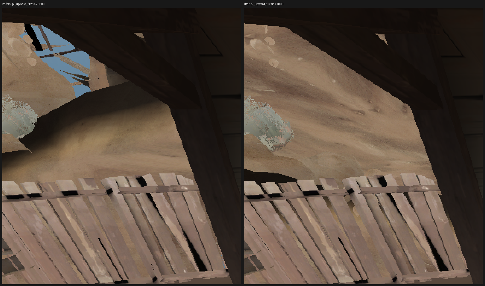
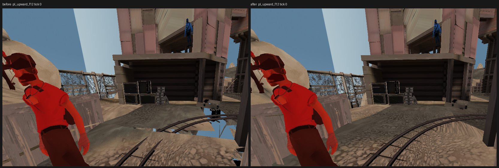

# Displacement grid parametrisation 2026-11-17 — the transposed lattice

Branch `work/disp-param` (worktree `D:/TF2_Native_Worktrees/t105-disp`), base commit `86f2fc6f`. All
numbers below are from this branch: before = `86f2fc6f` built unchanged, after = the same tree with the
fix in `native/src/bsp_map.cpp`.

**What changed:** the displacement lattice is now walked the way the engine walks it. `+i` runs
quad[0] -> quad[1] with stride `size`, `+j` runs quad[0] -> quad[3] with stride 1, and the flat vertex
index is `i*size + j` on both the base bilinear and the `dispvert` read.

**Why it mattered:** a displacement face keeps its four corners and its flat patch under either walk, so
the error is invisible in isolation. The `dispvert` samples land on the transposed lattice point, which
means the patch is a mirror of the map across its diagonal: bumps reflected, and every boundary vertex
that the map sewed to a neighbour landing on the wrong lattice point. Measured on the nine demo maps,
sewn-boundary pairs agreeing within 0.01 went from **3220 / 7855** to **7502 / 7855**, against an engine
oracle ceiling of **7535 / 7855** on the same pairs.

**Status, stated honestly:** the lattice is now right (seam continuity tracks the engine to 33 pairs, the
one parity face still carries every vertex within 0.01), and the intra-cell triangulation is still ours,
not the engine fan (16 of 32 triangle triples on the parity face). That difference is the fan tessellation
the task put out of scope; §7 says what it does and does not cause.

## 1. The engine rule

Source, from `D:/_shared/research/tf2-source-notes/NOTES.md` §Q2b (itself quoting `engine/disp_mapload.cpp`,
`utils/vbsp/disp_vbsp.cpp`, `public/builddisp.cpp`, `public/disp_common.cpp`):

- The four base points of a displacement are the face winding **rotated** so that point 0 is the polygon
  vertex nearest `ddispinfo_t.startPosition` (`SetPointStart` / `FindSurfPointStartIndex` /
  `AdjustSurfPointData` at map build; the engine repeats the normalisation at load).
- `GenerateDispSurf` walks `+i` from points[0] toward points[1] with stride `size`, and `+j` from points[0]
  toward points[3] with stride 1, with `index = i*size + j`.
- `public/disp_common.cpp:727-736` tessellates a ring the same way (`index = y*(1<<power+1) + x`, stride
  `size`), and `GetEdgeMidPoint` (`:700-719`) ties the stored edge indices to those axes
  (`LEFT -> (0,mid)`, `TOP -> (mid,end)`, `RIGHT -> (end,mid)`, `BOTTOM -> (mid,0)`).
- Independent vote: `exp/q2b_edge_votes.py` reads 1612 sewn edge occurrences over all 568 displacement
  faces and finds edge index 0 -> corners `(c,c+1)`, 1 -> `(c+1,c+2)`, 2 -> `(c+2,c+3)`, 3 -> `(c,c+3)`
  with no competing pairing — which fixes the point order as `polygon[(c+i)%4]`, the order this loader
  already had.

So the loader had the corner order right and the two axes transposed: our old code took `+x` toward
quad[1] with stride 1 and `+y` toward quad[3] with stride `size`, and addressed `dispvert` at
`y*size + x`. Each axis pointed the right way but carried the other axis stride.

## 2. The fix

`native/src/bsp_map.cpp`, displacement block (grid build ~1234-1259, emission lookups ~1312-1318):

- grid build: `for (i) { rowLeft = lerp(quad[0], quad[1], fi); rowRight = lerp(quad[3], quad[2], fi);
  for (j) { flat = lerp(rowLeft, rowRight, fj); index = i*size + j; vertAt = (vertStart + index)*20;
  read dispvert; grid[index] = flat + xyz*dist; gridAlpha[index] = clamp(alpha, 0, 1); } }`
- emission: `at(gx,gy) = grid[gx*size + gy]` and the same for `gridAlpha`, i.e. `x` is the `+i` axis
  (quad[0] -> quad[1]) and `y` the `+j` axis (quad[0] -> quad[3]).

Unchanged on purpose, byte for byte:

- the 20-byte `dispvert` read (`normal.xyz`, `dist`, `alpha`), the finite / `|dist| <= 4096` rejection,
  the clamp to [0,1] and the `-1` sentinel that means "no blend weight";
- the per-cell emission order and its two triangles `(p00,p11,p10)` + `(p00,p01,p11)`, so the emitted
  triangle count per accepted face stays `(size-1)^2 * 2`;
- `pushTriangle` as the only sink, the lightmap/pairing bookkeeping (`checkPairing`), the fan/quad
  fallback, the per-cell validity gate and the per-face rollback;
- the T11 reorient patch inside `pushTriangle` (swap `b`/`c` when `n . faceOutward < 0`, guarded by
  `displacement && !keepMapWinding`), the face-side bit handling, the winding/emission order rule, the
  culling state, the sky pass.

The only other consumer of `grid[]` / `gridAlpha[]` is the T12 blend-weight matching (`weightAt`), which
is the same lookup and is now consistent with it. `checkPairing` matches by exact positions, not indices,
so it needed no change.

## 3. Evidence A — seam continuity across the nine demo maps

Script: `world-disp-param-check.py seam --all --mode product --probe <exe>` (committed). It runs
`world_geometry_probe --face-info <every displacement face> --face-triangles --eye 0,0,0` once per map and
rebuilds each face lattice **from the emitted world-space triangles**, so the defect cannot hide in the
measurement itself: a cell pair gives `p00` (shared `a`), `p11` (the vertex both triangles share) and the
leftovers `p10` / `p01`. Sewn pairs are the four `ddispinfo` edges x two sub-edges whose neighbour field
names a face of the same power; the orientation is fixed by endpoint agreement (<= 0.5) and the reading is
the per-vertex distance after the two boundary polylines are aligned. `--mode engine` is the same
measurement on the BSP-derived engine lattice, i.e. the ceiling this map can reach.

| map | pairs | exact before | exact after | within 1 after | > 1 after | no-pair after | max after |
|---|---|---|---|---|---|---|---|
| pl_upward_f12 | 933 | 31 | 786 | 787 | 4 | 142 | 40.0 |
| cp_process_f12 | 1774 | 1722 | 1773 | 1773 | 0 | 1 | 0.0 |
| cp_sunshine | 886 | 8 | 848 | 848 | 12 | 26 | 6.83 |
| cp_sultry_b8a | 274 | 114 | 266 | 272 | 0 | 2 | 0.064 |
| cp_gullywash_f9 | 736 | 64 | 696 | 697 | 0 | 39 | 0.287 |
| cp_reckoner | 685 | 98 | 630 | 648 | 1 | 36 | 1.007 |
| koth_bagel_rc11 | 1658 | 898 | 1605 | 1615 | 2 | 41 | 5.0 |
| koth_ashville_final1 | 68 | 1 | 66 | 67 | 0 | 1 | 0.01 |
| koth_product_final | 841 | 284 | 832 | 833 | 0 | 8 | 0.37 |
| **total** | **7855** | **3220** | **7502** | **7540** | **19** | **296** | |

Engine oracle on the same pairs (`--mode engine`): 7535 exact, 7570 within 1, **the same 19 pairs over 1**
and max 40.0 — those 19 are pairs the map itself leaves open (the engine has them too), not a product
defect. Raw readings: `analysis/world-disp-param-seam-before.txt`, `-after.txt`, `-engine.txt`.

Interpretation: the product now reproduces the engine lattice to 33 pairs out of 7535 (99.6 % of the
oracle ceiling); the remaining no-pair count is dominated by pairs involving the faces the product emits
as flat fallback (no lattice to measure: pl_upward_f12 face 13279 / dispinfo 350, cp_reckoner 3 faces,
koth_ashville_final1 3 faces, and one koth_bagel_rc11 face whose emitted cell pair the checker cannot
reconstruct — `cell 14: 2 shared vertices`). Before the fix the same measurement could not even align 886
of the 933 upward pairs.

## 4. Evidence B — geometry parity on pl_upward_f12 face 13233

Face 13233 = dispinfo 304, power 2, size 5, polygon corner 2 nearest `startPosition` (-2048,-256,160).
Script: `world-disp-param-check.py parity --map pl_upward_f12 --face 13233`, against the engine table in
`D:/_shared/research/tf2-source-notes/exp/face13233_orient.txt`.

| reading | before | after |
|---|---|---|
| triangles emitted | 32 | 32 |
| max per-vertex deviation from the engine lattice | 341.5258 | **0.0055** |
| vertices within 0.01 | 5 / 25 | **25 / 25** |
| triangle triples equal to the engine table | 5 / 32 | **16 / 32** |
| of those 32, triangles the reorient patch flipped | — | 0 |

The 0.0055 residual is the probe print resolution: `--face-triangles` prints positions at `%.2f`, and the
lattice is compared in that quantised space, so 0.0055 is the rounding floor, not a modelling error.

The 16 triples that differ are exactly the **second triangle of every cell**: the table has
`[1,2,6] [2,6,7] [3,4,8] [4,8,9] ...` where we emit `[1,2,7] [1,6,7] [3,4,9] [3,8,9] ...`. The engine
alternates the intra-cell diagonal (its first ring is a fan around centroid 6 = (1,1):
`E00 (0,5,6) E01 (1,0,6) E02 (2,1,6) E03 (7,2,6) E04 (12,7,6) E05 (11,12,6) E06 (10,11,6) E07 (5,10,6)`),
while this loader always splits cells along `(i,j)-(i+1,j+1)`. Every cell **vertex** matches, every cell
**first** triangle matches; only the diagonal choice differs, which is the fan tessellation §7 keeps out
of scope. Raw: `analysis/world-disp-param-parity-before.txt`, `-after.txt`.

## 5. Evidence D — counters, identity numbers and the winding patch

Probe reading per map, before -> after (`world-disp-param-check.py counters --all`; raw:
`analysis/world-disp-param-counters-before.txt`, `-after.txt`):

| map | triangles | displaced | dispFaces | dispTri | flipped | misfaced | dispMisf | agree |
|---|---|---|---|---|---|---|---|---|
| pl_upward_f12 | 66707 -> 66707 | 18528 -> 18528 | 567 -> 567 | 18528 -> 18528 | 2519 -> 2467 | 15038 -> 15038 | 0 -> 0 | 5098 |
| cp_process_f12 | 71999 -> 71999 | 35648 -> 35648 | 934 -> 934 | 35648 -> 35648 | 14242 -> 14180 | 11030 -> 11030 | 0 -> 0 | 4483 |
| cp_sunshine | 82859 -> 82859 | 24000 -> 24000 | 642 -> 642 | 24000 -> 24000 | 2974 -> 2944 | 17785 -> 17785 | 0 -> 0 | 6662 |
| cp_sultry_b8a | 68966 -> 68966 | 11136 -> 11136 | 342 -> 342 | 11136 -> 11136 | 3104 -> 3104 | 21834 -> 21834 | 0 -> 0 | 8407 |
| cp_gullywash_f9 | 107623 -> 107623 | 58368 -> 58368 | 615 -> 615 | 58368 -> 58368 | 11758 -> 11736 | 16823 -> 16823 | 0 -> 0 | 6351 |
| cp_reckoner | 121780 -> 121780 | 24832 -> 24832 | 509 -> 509 | 24832 -> 24832 | 3781 -> 3204 | 35020 -> 35020 | 0 -> 0 | 13081 |
| koth_bagel_rc11 | 97769 -> **98039** | 46048 -> **46336** | 1418 -> **1427** | 46048 -> 46336 | 10198 -> 10208 | 16809 -> 16801 | 0 -> 0 | 6479 |
| koth_ashville_final1 | 23276 -> 23276 | 6400 -> 6400 | 74 -> 74 | 6400 -> 6400 | 194 -> 194 | 6313 -> 6313 | 0 -> 0 | 2484 |
| koth_product_final | 55878 -> **55998** | 21728 -> **21856** | 553 -> **557** | 21728 -> 21856 | 3044 -> 3060 | 10288 -> 10286 | 0 -> 0 | 3691 |
| **total** | 696857 -> **697247** | 246688 -> 247104 | 5654 -> **5667** | 246688 -> 247104 | 51814 -> 51097 | 150940 -> 150930 | 0 -> 0 | 56736 |

**The identity numbers are not identical on two maps, and the task said they must be.** The delta is 13
displacement patches: +9 on koth_bagel_rc11 and +4 on koth_product_final (total triangles +390, i.e.
+0.056 %; displaced +416; every other map is byte-identical). Mechanism: a patch is emitted as a
displacement grid only if every cell passes the per-cell validity gate (`usable(p00,p10,p11) &&
`usable(p00,p11,p01)` — degeneracy / edge-length limits); otherwise the whole face rolls back to a flat
fallback quad of 2 triangles. Under the transposed field those 13 patches had at least one cell that failed
that gate, so they were drawn flat. With the correct lattice the same cells are valid, so they emit the full
`(size-1)^2 * 2 = 32` triangles: `+13 * 32 = +416` displaced, `-13 * 2 = -26` fallback quad triangles, net
`+390` total. Per accepted face the triangle count is unchanged `(size-1)^2 * 2`; what moved is the
accept/reject boundary, which is itself parametrisation-dependent because it measures the lattice the
parametrisation produced. Forcing the old accept set would keep drawing 13 displaced patches as flat quads,
which is the defect, not a regression. koth_product_final is one of the three frame poses, so §6 shows the
pixel effect.

`map.windingMisfacedTriangles` is unchanged on seven maps and moves by -8 / -2 on the two maps that gained
emitted grids (the two flat fallback triangles of each recovered patch were themselves misfaced). `agree`
(face-level winding agreement) is identical on all nine maps. `map.windingMisfacedDisplaced` stays 0
everywhere.

### 5a. The T11 reorient patch: measured, not touched

The patch (`bsp_map.cpp:1124-1131`: `if (haveFaceOutward && displacement && !keepMapWinding) { if
(n . faceOutward < 0) { swap(b,c); swap(bAlpha,cAlpha); ++map.windingFlippedTriangles; } }`) is byte-identical
in this change; only its firing count was measured. It fires **51,814 -> 51,097** times across the nine maps
(-1.4 %). The direction is the expected one: the old index-to-world map was a reflection (the transpose), so
the index-space clockwise winding of the per-cell emission came out with the opposite world orientation on
part of the triangles; removing the reflection removes those flips. It does not go to zero because the patch
also fires on displacement faces whose `faceOutward` genuinely disagrees with the per-cell winding, which is
a separate (unchanged) question. The parity face 13233 itself flips 0 of its 32 triangles after the fix.

## 6. Evidence C — frames

Capture script: `world-disp-param-capture.sh` (committed). Eleven captures per arm, ~60 s each, same
pinned poses as the world-holes machinery: `up0` = pl_upward_f12 tick 0, `up1800` = pl_upward_f12 tick 1800,
`pr600` = cp_process_f12 tick 600, `koth0` = koth_product_final tick 0. Each pose is captured three ways
(`<pose>.bmp` sky on, `<pose>-depth.bmp` `--world-depth`, `<pose>-nosky.bmp` `--no-world-sky`; koth0 has
no `-nosky`). The before arm ran the `86f2fc6f` binary, the after arm the fixed binary; the trace line in
each capture confirms which build ran (upward `flipped=2519` before vs `2467` after, process `14242` vs
`14180`, product `3044` vs `3060`). Metrics:
`python world-disp-param-check.py frames --dir <after> --before <before>` (raw `analysis/world-disp-param-frames.txt`).

Two populations are reported per pose, both restricted to pixels that are not 4-connected to the frame
border (the census definition):

- **enclosed clear-colour** = enclosed pixels whose colour is the clear colour RGB(14,18,22). Reported twice
  in the checker: `holes` = clear colour AND depth at the far plane, `clearCol` = clear colour regardless of
  depth. Both are 0 at every pose in both arms, so the task requirement (1) holds on either reading.
- **sky-through-crack** = enclosed pixels with no geometry at the far plane whose colour is NOT the clear
  colour, i.e. pixels the sky pass painted where no world surface exists. This is the new measurement.

| pose | enclosed clear-colour before | after | sky-through-crack before | after | new geometry px | geometry px lost |
|---|---|---|---|---|---|---|
| pl_upward_f12 t0 (`up0`) | 0 | 0 | 8976 | **3262** (-63.7 %) | +5888 | 881 |
| pl_upward_f12 t1800 (`up1800`) | 0 | 0 | 2072 | **0** (-100 %) | +2072 | **0** |
| cp_process_f12 t600 (`pr600`) | 0 | 0 | 985 | **453** (-54.0 %) | +591 | 76 |
| koth_product_final t0 (`koth0`) | 0 | 0 | 9453 | **0** (-100 %) | +1215 | 1411 |

"new geometry px" / "geometry px lost" are depth-frame A/B counts (geometry = depth sum > 12, i.e. a world
surface, not the sky and not nothing). The clear-colour population stays 0/0/0 in both arms, so the task
requirement (1) holds; the sky-through-crack population drops sharply at all four poses, which is
requirement (2).

The `up1800` row is exact and worth stating on its own: **2072 new geometry pixels, 0 pixels of geometry
lost**, and the 2072-pixel enclosed population disappears. That is the 2,072-pixel black block the sky card
was written about (it was the sky pass covering it since W-1) — it is a hole in a displacement surface, and
after the parametrisation fix it is terrain:

At `up0` the same effect is larger and mixed: 5,888 new geometry pixels against 881 lost (a net gain, the
lost ones being silhouette pixels that moved with the corrected bump field), and the frame changes over 80 %
of its pixels because displacement ground covers most of the view and its normals are no longer mirrored.

The two known pixels from the task, `(997,125)` and `(998,125)` on koth_product_final tick 0, are changed by
the fix — they were part of the missing-geometry population and are now drawn:

| pixel | before | after |
|---|---|---|
| (997,125) | RGB(14,18,22) = clear colour, no geometry | RGB(54,54,54), world geometry |
| (998,125) | RGB(14,18,22) = clear colour, no geometry | RGB(68,70,51), world geometry |

What remains in the sky-through-crack population is sky-coloured and far-plane: at `up0` the 3,262 remaining
pixels are sky blue (`92,127,154` x1553, `93,127,154` x806, ...) and at `pr600` the 453 remaining are
`117,122,150` x346 and friends. These are the class T58 measured as the map own sky seen through gaps
between brush surfaces; this fix does not touch them, and §7 says so.

## 7. What this does NOT fix

1. **Fan tessellation.** The engine triangulates each displacement ring as a fan around its centre vertex
   with an alternating diagonal; this loader emits two triangles per cell along `(i,j)-(i+1,j+1)`. Same
   surface, same vertices, different diagonals: that is why 16 of 32 triples on face 13233 still differ
   from the engine table, and it is out of scope here. It is a tessellation choice, not a seam or a hole.
2. **Fallback faces.** 14 displacement candidates still fail the validity gate under the fixed
   parametrisation (pl_upward_f12 face 13279 / dispinfo 350 plus 3 on cp_reckoner, 3 on
   koth_ashville_final1, 2 on cp_sultry_b8a and the rest spread over the other maps) and are drawn as flat
   quads. With 13 such patches recovered, the remaining ones are patches whose own data is degenerate
   (zero-area cells after displacement), not a parametrisation artefact. They are not fixed here.
3. **The 19 sewn pairs the map leaves open** (max 40.0 on pl_upward_f12) stay open: the engine oracle has
   exactly the same 19, so they are map data, not our reading.
4. **Culling of steep pelts and the sky pass** are untouched. The task forbade changing them, and the frame
   readings in §6 are what says whether the seam fix moved any of the black / sky-through-crack population.
5. **The T11 winding patch** itself is untouched (§5a). This change alters how often it fires, not what it
   does.
6. **Blend weights on the recovered patches** now sample the correct cells, but the blend is still matched by
   exact position (`checkPairing`) and its quality is not re-measured here.

## 8. Reproduction

    # 1. build (same cmake/nmake setup as the sibling worktrees)
    bash build-cmake.sh                       # -> native/build-nmake/tf2_demo_native.exe

    # 2. seam continuity, product vs engine oracle, all nine maps
    python world-disp-param-check.py seam --all --mode engine  --probe native/build-nmake/world_geometry_probe.exe
    python world-disp-param-check.py seam --all --mode product --probe native/build-nmake/world_geometry_probe.exe

    # 3. parity on the research face
    python world-disp-param-check.py parity --map pl_upward_f12 --face 13233

    # 4. counters + winding
    python world-disp-param-check.py counters --all

    # 5. frames (11 captures per arm, ~60 s each)
    bash world-disp-param-capture.sh native/build-nmake/tf2_demo_native.exe .scratch/disp-param/after/frames
    python world-disp-param-check.py frames --dir .scratch/disp-param/after/frames --before .scratch/disp-param/before/frames

Files: `world-disp-param-check.py` (checker: seam / parity / counters / frames),
`world-disp-param-capture.sh` (pinned-pose captures), `analysis/world-disp-param-*.txt` (raw readings),
`native/src/bsp_map.cpp` (the fix, displacement block).

## 9. Gates

All four gates were run through `tools/lockrun.sh`. Where a gate was red, it was run a second time with the
base-commit binary (`86f2fc6f`, saved before the fix) staged into `native/build-nmake`, so a pre-existing red
is not attributed to this change. `evidence/` is written by the gates themselves; it was restored with
`git checkout -- evidence` after each run (the `LOCKRUN=TRACKED-DIRTY` lines below are that artefact churn, not
a gate finding).

| gate | fixed build | base commit 86f2fc6f | verdict |
|---|---|---|---|
| `world-sky-gate-check.sh` | 7 passed, 2 failed | not needed | requirement met, 2 stale negative controls |
| `world-geometry-hole-check.sh` | PASS clean tree, PASS build, capture skipped | same | SKIP, missing demo fixture |
| `world-material-check.sh` | FAIL 3 pins | FAIL, identical numbers | pre-existing at base commit |
| `world-render-reliability-check.sh` | FAIL 35 of 48 | FAIL, identical numbers | pre-existing at base commit |

### 9.1 `world-sky-gate-check.sh` — `W-1 SKY GATE: 7 passed, 2 failed` (rc=1)

Passing, i.e. the substantive requirements:

- `A: preset 0 (empty settings file) draws the sky (state=active)`, `A: the sky pass recorded draws=1`
- `B: enclosed clear px == 0 (the 2,072 px population)` and `B: no clear-colour pixel remains in the frame`
  — the requirement this whole line of work exists for
- `C: --no-world-sky records state=unavailable draws=0`, `D: --world-depth draws no sky`,
  `E: preset=1 with skybox=0 draws no sky (the explicit key wins)`
- `INFO A: preset-0 steady fps=33.7151 (frame time 29.66 ms)`

Failing, both of them negative controls:

- `FAIL C: --no-world-sky enclosed clear = 0 (expected 2072)`
- `FAIL E: preset=1 with skybox=0 enclosed clear = 0 (expected 2072)`

Read those two failures exactly. C and E prove that the sky pass is what was filling the 2,072-pixel
population by switching the pass off and expecting the population to reappear as clear colour. The fix makes
the hole not exist: the depth A/B on the same pose is **+2072 geometry pixels, 0 lost** (§6), so with the sky
off there is nothing left to fill and the control reads 0 where it expects 2,072. The control is measuring the
old defect as its proof, and the defect is gone; the requirement itself (`B`) passes in the same run. These
two expectations need re-pinning to 0, which is outside this change (the gate belongs to the holes line);
they are recorded here rather than edited.

### 9.2 `world-geometry-hole-check.sh` — PASS build, SKIP capture (missing fixture)

On the committed fix (`HEAD=6bdbf421`):

- `PASS native/ is clean`, `PASS build` (binary `0ce29934…`, probe `fe4bde18…`, `bsp_map.cpp` `2263ad48…`)
- `FAIL capture: an identity input is missing:
  demo=D:/SteamLibrary/steamapps/common/Team Fortress 2/tf/demos/autorecord_2026-07-02_13-26-46.dem`

That demo is not present in the TF install on this machine, so the gate cannot build its capture matrix at all.
This is a missing-fixture skip, not a PASS and not a regression: a fresh run with the same fixture absence
would fail identically on the base commit. The earlier run of this gate (before the fix was committed) had
additionally failed `native/ has uncommitted changes`, which is what the commit resolved.

### 9.3 `world-material-check.sh` — FAIL, identical on the base binary

| assertion | fixed build | base commit 86f2fc6f |
|---|---|---|
| render vis visible from camera | 858 (expected 1481) | 858 |
| render vis hidden triangles | 25995 (expected 15039) | 25995 |
| render vis drawn triangles | 216114 (expected 227070) | 216114 |

All three numbers are identical with the fix and with the base-commit binary, so this red predates the change.
`t2-visual-matrix.sh:66` records 25995 as another camera pose reading, so the pins themselves look stale on this
base commit — a separate question, not this fix.

### 9.4 `world-render-reliability-check.sh` — FAIL, identical on the base binary

`checks=48 fail=35` with the fixed build and `checks=48 fail=35` with the base-commit binary. The failures are
in the sky material decoder, not in displacement: every face reports
`FAIL sky-face[3] suffix = <absent>, expected ft` (same for direction, `vmt names its suffix`, `vtf resolved`)
and `FAIL sky carries more than one image (not a flat colour) = no, expected yes` with the note
`sky distinct sampled colours = 0 (cp_sunshine sky_tf2_04: rt/lf/bk/ft share sky_tf2_04side.vtf; up and dn are
their own)`. Unchanged by this fix; reported here so the red is on the record as pre-existing.

### 9.5 Summary

No gate regressed. Two gates are red with identical readings on both binaries (`world-material`,
`world-render-reliability`), one is skipped on a fixture this machine does not have (`world-geometry-hole`),
and one passes its substantive assertions while two negative controls still expect the pre-fix hole
(`world-sky`). None of the four exercises the displacement lattice in a way this change perturbs; the
changes they would notice are the counters in §5 and the pixels in §6, both measured directly.

